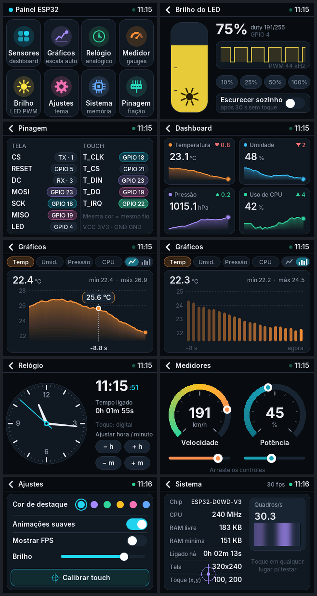

# Painel ESP32: tela touch 2.8" com interface moderna

Demonstração de interface gráfica para **ESP32 DevKit (38 pinos)** com **TFT 2.8" SPI 240×320 (ILI9341) e touch resistivo XPT2046**.
Tem tema escuro, fontes suavizadas com acentos, ícones vetoriais, botões com esmaecimento e efeito "ripple", e gráficos que se movem e ajustam a escala sozinhos.



## O hardware das fotos

| Item | O que é |
|---|---|
| Placa vermelha "2.8" TFT 240xRGBx320 V1.1" | Display TFT SPI **ILI9341** de 240×320 pixels e 65 mil cores |
| Chip **U1** ao lado de `T_IRQ / T_DO / T_DIN / T_CS / T_CLK` | **XPT2046**, o controlador do touch resistivo. Ele usa SPI e pode dividir o mesmo barramento da tela |
| **Q1** + pino `LED` | Transistor do backlight. Ligue o LED no 3V3 para luz fixa ou num GPIO para controlar o brilho por PWM |
| **SD1** + `SD_SCK/MISO/MOSI/CS` | Slot de cartão SD (não é usado nesta demo) |
| Placa preta **ESP32 DevKit 38 pinos** (ESP-WROOM-32) | 240 MHz, dois núcleos, cerca de 320 KB de RAM, **sem PSRAM** |
| Placa roxa | Shield de expansão no padrão Arduino, com fonte DC 6.5–16 V, jumper 5 V/3.3 V e barras de pinos coloridas (sinal/VCC/GND) |

## Ligação (pinos)

Esta é a ligação desta montagem, já configurada em [`config.h`](esp32_tft_touch_demo/config.h). A tela e o touch dividem o mesmo barramento SPI.

| Tela | ESP32 | | Tela | ESP32 |
|---|---|---|---|---|
| VCC | 3V3 (ou 5V) | | SDO(MISO) | GPIO 19 |
| GND | GND | | T_CLK | GPIO 18 (mesmo fio do SCK) |
| CS | **TX** (GPIO 1) | | T_CS | GPIO 21 |
| RESET | GPIO 5 | | T_DIN | GPIO 23 (mesmo fio do MOSI) |
| DC | **RX** (GPIO 3) | | T_DO | GPIO 19 (mesmo fio do MISO) |
| SDI(MOSI) | GPIO 23 | | T_IRQ | GPIO 22 |
| SCK | GPIO 18 | | LED | GPIO 4 (brilho por PWM) |

> **TX/RX:** CS e DC estão nos pinos da USB-serial. Por isso o programa **não usa `Serial`** e o Monitor Serial fica sem mensagens.
> Se a gravação falhar com a tela ligada, desconecte os fios de CS e DC, grave e reconecte.

## Como gravar

### Arduino IDE
1. Instale o suporte ao ESP32 (Gerenciador de Placas: *esp32 by Espressif*).
2. Em *Gerenciar bibliotecas*, instale **LovyanGFX** (by lovyan03).
3. Abra `esp32_tft_touch_demo/esp32_tft_touch_demo.ino`.
4. Placa: **ESP32 Dev Module**. Grave.

### PlatformIO (VS Code)
Abra a pasta do repositório e clique em *Upload*. O `platformio.ini` já baixa a biblioteca.

### Primeira vez
A tela pede para você **tocar nas setas dos 4 cantos** (calibração). O resultado fica salvo na flash.
Para calibrar de novo, use **Ajustes → Calibrar touch** ou mantenha o dedo na tela enquanto liga a placa.

## O que tem na demo

| Tela | Destaques |
|---|---|
| **Início** | 8 blocos com ícones vetoriais. Ao tocar, o bloco acende e uma "onda" (ripple) se espalha a partir do dedo |
| **Sensores** (dashboard) | 4 sensores simulados com valor animado, seta de tendência e mini-gráfico com degradê. Toque num cartão para abrir o gráfico dele |
| **Gráficos** | Linha ou barras, com rolagem suave e **auto-escala animada** (a CPU tem picos de propósito, para a escala mudar). Arraste o dedo sobre o gráfico para ver o valor de cada ponto |
| **Relógio** | Analógico com ponteiro de segundos suave. Toque nele para mudar para o digital. Botões para ajustar hora e minuto |
| **Medidor** | Dois gauges com ponteiro "elástico" (efeito mola), controlados por sliders |
| **Brilho** | Controle do LED (GPIO 4, PWM): slider vertical grande, atalhos 10/25/50/100%, desenho da onda PWM com o duty cycle real e opção de escurecer após 30 s sem toque. O LED muda de brilho com fade suave |
| **Ajustes** | Cor de destaque (6 temas), liga/desliga animações, contador de FPS, brilho, calibração |
| **Sistema** | Chip, CPU, RAM livre, tempo ligado, gráfico de FPS e teste de precisão do toque |
| **Pinagem** | Mostra a ligação configurada. Fios compartilhados aparecem com a mesma cor, e o T_IRQ acende enquanto você toca |

Cor de destaque, animações, FPS, brilho e "escurecer sozinho" ficam salvos na flash e voltam quando a placa é religada.

## Problemas comuns

| Sintoma | O que fazer (`config.h`) |
|---|---|
| Tela branca | Confira CS/DC/RST/MOSI/SCK. Se usar fios longos, baixe `SPI_FREQ_WRITE` para `20000000` |
| Cores invertidas (fundo branco) | `PANEL_INVERT true` |
| Vermelho e azul trocados | `PANEL_RGB_ORDER true` |
| Imagem de cabeça para baixo | `SCREEN_ROTATION 3` |
| Imagem estranha mesmo com tudo certo | Troque `PANEL_ILI9341` por `PANEL_ST7789` |
| Toque no lugar errado | Recalibre em Ajustes. A tela **Sistema** mostra onde o toque foi lido |
| Toque não responde | Confira T_CS (21) e se T_DO/T_DIN/T_CLK estão nos mesmos pinos de MISO/MOSI/SCK |

## Como funciona (resumo técnico)

- **Sem tremulação:** um quadro inteiro de 320×240 em 16 bits ocupa 150 KB, e o ESP32 não tem um bloco de RAM livre desse tamanho. Por isso a cena é desenhada em **2 faixas de 120 linhas** num buffer de 75 KB. Cada faixa fica pronta na RAM e só então vai para a tela via SPI/DMA.
- **Fontes:** as fontes que vêm na LovyanGFX só têm ASCII. As deste projeto são geradas da fonte [Inter](https://rsms.me/inter/) (licença OFL) com anti-aliasing, acentos e `°`. Para mudar tamanhos ou caracteres, edite e rode `tools/gen_fonts.py`.
- **Animações independentes do FPS:** tudo usa interpolação exponencial baseada no tempo (`approach()`), então a velocidade das animações é a mesma a 15 ou a 40 FPS.
- **Organização:** `ui.cpp` contém só a interface e não sabe em que hardware está rodando. O `.ino` implementa as funções de `platform.h` para o ESP32: touch, memória, brilho e calibração.

```
esp32_tft_touch_demo/
  esp32_tft_touch_demo.ino   setup/loop, calibração (Preferences)
  config.h                   PINOS e opções do painel  <- edite aqui
  lgfx_esp32.h               configuração LovyanGFX (ILI9341 + XPT2046)
  ui.cpp / ui.h              todas as telas, widgets e animações
  platform.h                 funções que dependem do hardware
  fonts_inter.cpp/.h         fontes geradas (não editar)
tools/gen_fonts.py           gerador das fontes
simulator/                   roda a mesma interface no PC (SDL2)
```

## Simulador no PC (opcional)

Dá para testar e mudar o visual sem gravar na placa. O mouse faz o papel do dedo:

```bash
sudo apt install libsdl2-dev cmake g++
cd simulator
git clone --depth 1 https://github.com/lovyan03/LovyanGFX.git
cmake -B build && cmake --build build -j
./build/tft_sim
```
